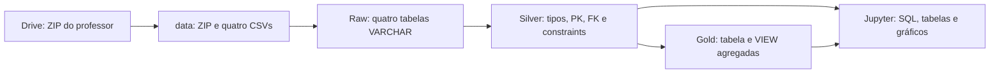
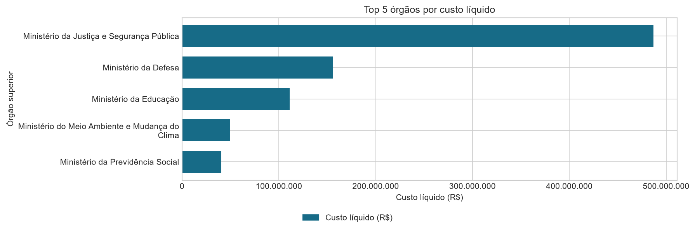
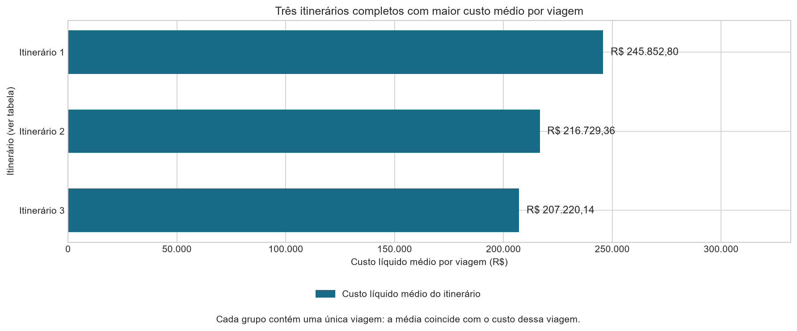
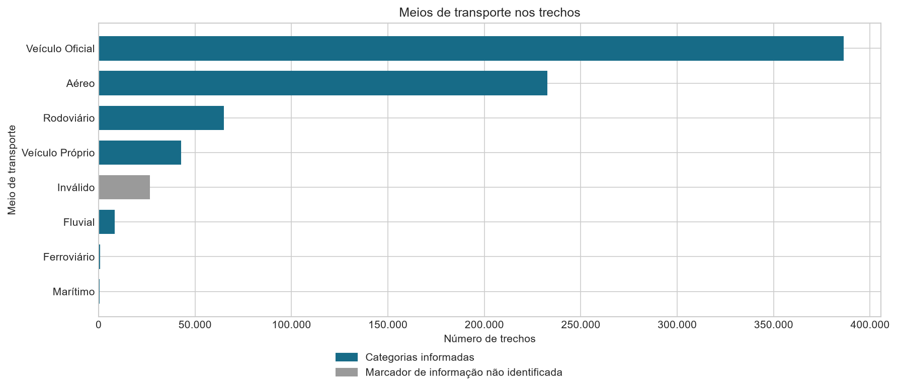

# Viagens a Serviço — Pipeline de Dados Públicos

**Diego Nogueira · Análise de Dados com Python [T6] · Módulo 1, Semana 13**

## Objetivo

Transformar os dados de viagens a serviço em informação confiável sobre gastos,
destinos, duração, pagamentos e deslocamentos. O pipeline aplica a arquitetura
Medallion com Python e PostgreSQL, preservando a fonte e registrando rejeições.

O projeto segue o edital de viagens. O roteiro de cafeteria fornecido em aula é
referência para a estrutura e a sequência de execução, adaptadas ao domínio avaliado.

**Fonte:** recorte de seis meses de 2025 fornecido pelo professor, derivado do Portal
da Transparência. O download usa o [ZIP da atividade](https://drive.google.com/file/d/1pQjKacyHdIsyteknQbwKGM5_4hL5V4RV/view).
Esse recorte é a versão de referência fornecida para a atividade.

## Arquitetura



| Ordem | Arquivo | Responsabilidade |
|---|---|---|
| 0 | `0_criar_banco.py` e `0_criar_banco.sql` | Inicializar database e oito tabelas |
| 1 | `1_extrair.py` | Baixar, extrair e carregar Raw em blocos |
| 2 | `2_transformar.py` | Converter, validar e carregar Silver |
| 3 | `3_analise.ipynb` | Responder às sete perguntas e construir Gold |

Tecnologias: Python, PostgreSQL, Psycopg 3, SQLAlchemy, pandas, Matplotlib, JupyterLab,
python-dotenv, gdown e bibliotecas padrão de CSV, ZIP, datas e decimais.

## Organização

```text
├── .env.example             # Modelo versionado sem senha
├── .env                     # Credenciais locais; fora do Git
├── .gitignore
├── requirements.txt
├── requirements.lock.txt     # Versões do ambiente validado
├── requirements-dev.txt      # Ferramentas de revisão
├── pyproject.toml            # Padrão de formatação e lint
├── CONTRIBUTING.md           # Continuidade e GitFlow
├── config.py                # Leitura do .env e parâmetros
├── banco.py                 # Conexão e utilitários
├── modelo.py                # Correspondência das colunas Raw
├── 0_criar_banco.py
├── 0_criar_banco.sql
├── 1_extrair.py
├── 2_transformar.py
├── 3_analise.ipynb
├── sql/3_gold.sql
├── scripts/                 # Preparação, execução e validação
├── tests/                   # Testes de conversão
├── reports/                 # Evidências e gráficos agregados
├── data/                    # ZIP, quatro CSVs, manifesto e rejeições; fora do Git
└── .venv/                   # Bibliotecas locais; fora do Git
```

## Instalação

Pré-requisitos: Python 3.11 ou superior, PostgreSQL em execução e Git. Na primeira
execução, o usuário precisa de permissão para criar o database caso ele não exista.

```powershell
git clone https://github.com/DiegoNogueira-DataAnalyst/Projeto_Avaliativo_Modulo1_DiegoNogueira.git
cd Projeto_Avaliativo_Modulo1_DiegoNogueira
python -m venv .venv
.\.venv\Scripts\Activate.ps1
python -m pip install -r requirements.txt
Copy-Item .env.example .env
```

No `.env` local, confira os parâmetros de conexão `DB_HOST`, `DB_PORT`, `DB_NAME`
e `DB_USER` e preencha `DB_PASSWORD` conforme sua instalação do PostgreSQL.
O banco configurado é
`Projeto_Avaliativo_Modulo1_DiegoNogueira`, com maiúsculas preservadas e sem espaços
no começo ou fim. Senhas com caracteres especiais podem ser delimitadas por aspas.
Nunca versionar ou exibir o conteúdo do `.env` em logs ou screenshots.

Os parâmetros de extração já estão preenchidos no `.env.example` e têm os mesmos
valores padrão no `config.py`; não é necessário alterá-los para usar a base fornecida:

| Parâmetro | Finalidade | Valor padrão |
| --- | --- | --- |
| `DRIVE_FILE_ID` | Identifica o ZIP no Google Drive, no trecho `/file/d/ID/view` do link. É usado pelo download automático. | `1pQjKacyHdIsyteknQbwKGM5_4hL5V4RV` |
| `CHUNK_SIZE` | Define a quantidade de linhas lidas por bloco na carga Raw, para controlar o uso de memória. Todos os blocos são processados até o fim do CSV. | `10000` |

O `DRIVE_FILE_ID` está previsto na seção 5.2 do edital. O `CHUNK_SIZE` é uma
configuração da implementação para atender à leitura em blocos exigida na fase 1;
ele não limita a quantidade total de registros nem altera o período dos dados.
O download requer acesso à internet e permissão de leitura do arquivo no Google Drive.

`requirements.lock.txt` registra as versões instaladas no Windows com Python 3.14.
Para reproduzir esse ambiente, use `python -m pip install -r requirements.lock.txt`.
As ferramentas opcionais de desenvolvimento estão em `requirements-dev.txt`.

Se a ativação for bloqueada, use `.\.venv\Scripts\python.exe` no lugar de `python`.
No VS Code, abra esta pasta e selecione esse interpretador e o mesmo kernel no notebook.

## Execução

```powershell
python 0_criar_banco.py
python 1_extrair.py
python 2_transformar.py
python scripts/validar_pipeline.py --silver
python -m jupyterlab 3_analise.ipynb
```

No Jupyter, execute todas as células em ordem. O notebook cria a tabela `gold_metricas`
e a VIEW `vw_gold_metricas` com o SQL de `sql/3_gold.sql`. Alternativa sem interação:

```powershell
python scripts/executar_notebook.py
python scripts/validar_pipeline.py
python -m unittest discover -s tests -v
```

O inicializador Python executa o DDL do arquivo SQL, sem duplicar a modelagem no código.
Alternativa: `psql -U postgres -d postgres -f 0_criar_banco.sql`. O arquivo contém
metacomandos do cliente psql e não deve ser colado integralmente no Query Tool do pgAdmin.

O download padrão é automático. Para reprocessar um ZIP já existente em `data/`, use
`python 1_extrair.py --local`. Se o ZIP foi recebido na raiz, execute uma vez
`python scripts/preparar_dados.py`. A extração dos quatro CSVs é feita pelo próprio pipeline.

## Regras de dados

### Raw: preservação e rastreabilidade

Viagem contém 22 colunas; Pagamento, 10; Passagem, 19; Trecho, 14. Todas são preservadas
como `VARCHAR`, sem constraints. Os CSVs usam separador `;`, encoding Latin-1, valores
com vírgula decimal e datas `DD/MM/AAAA`. Campos vazios e espaços são preservados.
Aspas e delimitadores são interpretados pelo leitor de CSV; o ZIP preserva os bytes
originais. `data/manifesto.json` registra cabeçalhos, contagens e SHA-256 do ZIP.

A Raw é carregada em blocos por `COPY`, com `TRUNCATE` e uma única transação para os
quatro arquivos. Uma falha reverte a carga no banco. O ZIP e os CSVs permanecem em `data/`.

### Silver: modelo relacional

| Tabela | Chave e relacionamento | Duas constraints extras do edital |
|---|---|---|
| `silver_viagem` | PK `id_viagem` | Órgão superior NOT NULL; diárias >= 0 |
| `silver_pagamento` | PK identity; FK viagem NOT NULL | Tipo NOT NULL; valor >= 0 |
| `silver_passagem` | PK identity; FK viagem NOT NULL | Passagem >= 0; taxa >= 0 |
| `silver_trecho` | PK identity; FK viagem NOT NULL | Diárias >= 0; UNIQUE viagem + sequência |

`GENERATED ALWAYS AS IDENTITY` corresponde ao auto incremento no PostgreSQL. O DDL
contém todos os nomes, tipos e tamanhos do dicionário do edital, com PK, FK e constraints
dentro de cada `CREATE TABLE`.

- Datas são convertidas para `DATE`; valores para `DECIMAL`, usando `Decimal` em Python.
- Textos são aparados somente na Silver; campos vazios passam a nulo.
- Datas inválidas, valores incompatíveis com CHECK, textos maiores que o limite e
  registros órfãos são rejeitados, sem inventar correções ou truncar textos.
- Rejeições são identificadas por tabela, linha Raw, viagem e motivo em `data/quality/`.
- Viagens e trechos preservam a primeira ocorrência da chave na carga Raw.
- Pagamentos e passagens são deduplicados pela linha completa do CSV original. A fonte
  não traz identificador próprio desses eventos; eventos legítimos idênticos podem
  ser indistinguíveis de duplicatas, limitação que acompanha os resultados.
- Nulos monetários não viram zero. O custo total é nulo se faltar algum componente;
  somas e médias SQL ignoram esses custos. O notebook mostra essa cobertura.
- `valor_total = valor_diarias + valor_passagens + valor_outros_gastos - valor_devolucao`.
- `duracao_dias = data_fim - data_inicio + 1`, incluindo os dias inicial e final.

### Gold: definições e perguntas

| Pergunta | Fonte | Entrega |
|---|---|---|
| Cinco órgãos com maior custo total | Silver Viagem | SQL, tabela e gráfico |
| Três destinos com maior custo médio | Silver Viagem | SQL, tabela e gráfico |
| Viagem de maior duração e seu custo | Silver Viagem | SQL, tabela e gráfico |
| Tipo de pagamento com maior valor médio | Gold | Tabela e gráfico |
| Transporte mais usado nos trechos | Gold | Tabela e gráfico |
| UF mais frequente nos trechos | Gold | Tabela e gráfico |
| Órgão com maior total pago | Gold | Tabela ordenada |

“Destino” representa o itinerário completo em `destinos`: não se atribui o custo
inteiro de uma viagem a cada cidade. Órgão superior da viagem e órgão pagador são
dimensões diferentes. Custo líquido e total pago também são medidas diferentes.
Pagamentos e trechos são agregados separadamente com `JOIN` e `GROUP BY`, evitando
multiplicar valores ao cruzar duas relações de um para muitos.

A granularidade da Gold é uma linha por `(metrica, dimensao)`. As consultas filtram
`metrica`: `tipo_pagamento` e `orgao_pagador` são duas agregações dos mesmos pagamentos;
`meio_transporte` e `uf_destino` são duas agregações dos mesmos trechos. Os totais
pertencem a cada conjunto de indicadores e não são aditivos entre esses conjuntos.

A VIEW acompanha a Silver; a tabela Gold é uma fotografia. Depois de reprocessar
a Silver, execute a etapa 3 para atualizar a tabela. Os seis gráficos têm título,
eixos nomeados, unidades e legenda.

## Validação da carga

| Tabela | Raw | Silver | Duplicatas desconsideradas |
|---|---:|---:|---:|
| Viagem | 341.860 | 341.860 | 0 |
| Pagamento | 606.916 | 568.811 | 38.105 |
| Passagem | 167.260 | 167.210 | 50 |
| Trecho | 763.349 | 763.349 | 0 |
| **Total** | **1.879.385** | **1.841.230** | **38.155** |

As rejeições registradas neste recorte correspondem somente a duplicatas de linha
completa após normalização de espaços. A Raw mantém todos os registros originais.
Não foram identificadas rejeições por conversão, CHECK, tamanho de campo ou registro
órfão. As constraints e os cálculos também foram conferidos no banco real.

Evidências versionadas:

- [Idempotência Raw](reports/idempotencia.json): reexecução com contagens e fingerprint iguais.
- [Integridade Silver](reports/validacao_silver.json): reconciliação e motivos das rejeições.
- [Reversão transacional](reports/rollback.json): interrupção controlada sem carga parcial.

## Resultados e limites analíticos

As respostas foram calculadas no [notebook executado](3_analise.ipynb) e exportadas
para [resultados completos](reports/resultados.json). A [validação integrada](reports/validacao.json)
confere a tabela Gold, a VIEW e as tabelas de origem. Os [metadados da fonte](reports/fonte.json)
registram cabeçalhos, contagens e SHA-256 do ZIP utilizado.

### Cinco órgãos com maior custo líquido

| Órgão superior | Custo líquido |
|---|---:|
| Ministério da Justiça e Segurança Pública | R$ 486.933.121,65 |
| Ministério da Defesa | R$ 156.070.304,49 |
| Ministério da Educação | R$ 111.291.349,34 |
| Ministério do Meio Ambiente e Mudança do Clima | R$ 49.697.710,16 |
| Ministério da Previdência Social | R$ 40.417.309,06 |

Esses cinco órgãos concentram **71,1%** do custo líquido conhecido. Esse indicador
descreve concentração de gastos; não demonstra irregularidade.



### Três destinos com maior custo médio: itinerários completos

| Referência no gráfico | Localidades (resumo) | Viagens | Custo médio por viagem |
|---|---|---:|---:|
| Itinerário 1 | Abu Dabi/Emirados Árabes, Riad/Arábia Saudita, Rio de Janeiro/RJ | 1 | R$ 245.852,80 |
| Itinerário 2 | Brasília/DF, Rio Branco/AC, Cruzeiro do Sul/AC, outras localidades | 1 | R$ 216.729,36 |
| Itinerário 3 | Brasília/DF, Rio de Janeiro/RJ, Angra dos Reis/RJ, outras localidades | 1 | R$ 207.220,14 |

Cada grupo corresponde ao campo `destinos` completo, que pode conter várias cidades.
Os resumos mostram até três localidades distintas e não indicam a ordem dos deslocamentos.
As listas integrais, incluindo repetições, permanecem no [JSON de resultados](reports/resultados.json),
na seção `p2`; a abreviação não altera o agrupamento nem os cálculos.

Cada grupo contém **uma única viagem**, portanto a média coincide com o custo dessa
viagem. O ranking caracteriza esses itinerários específicos, sem estimar o custo
típico de uma cidade e sem repartir os gastos entre as localidades.



### Demais respostas

| Pergunta | Resultado observado |
|---|---|
| Maior duração e custo | Processo `0000000000020699856`: 384 dias inclusivos, de 13/01/2025 a 31/01/2026, com custo líquido registrado de R$ 0,00 |
| Tipo de pagamento com maior média | PASSAGEM: R$ 1.856,78 por registro |
| Transporte mais usado nos trechos | Veículo Oficial: 386.424 trechos, equivalentes a 50,6% dos registros aceitos |
| UF de destino mais frequente | São Paulo: 82.722 trechos, equivalentes a 10,8% do total |
| Maior total pago por rótulo | `Sigiloso`: R$ 170.659.883,35; a categoria não identifica um órgão único |
| Maior órgão com nome divulgado | Fundo Nacional de Segurança Pública: R$ 141.911.719,64 |

A duração representa o período informado na proposta, preservando inclusive o término
em 2026. A situação registrada é `Realizada`, detalhada no notebook. O valor zero e o período
informado, isoladamente, não comprovam ausência de despesa efetiva ou deslocamento
contínuo durante todo o intervalo.

`Sigiloso` é um marcador de divulgação, e não um nome institucional. A identificação
do maior órgão individual fica limitada por essa parcela não atribuível da fonte.
Os registros também contêm 26.659 trechos com transporte rotulado `Inválido`, 14.742
com UF não informada e 29 com UF rotulada `Inválido`. Esses marcadores são mantidos
para rastreabilidade e apresentados separadamente como limitações de classificação.



As [conclusões detalhadas](reports/insights.md) e os [seis gráficos](reports/figures/)
acompanham as sete respostas. A [qualidade das categorias](reports/qualidade_categorias.json)
permite conferir os rótulos sem identificação válida.

Concentração de gastos não comprova irregularidade. Médias precisam ser lidas junto
à quantidade de viagens. Trechos não representam pessoas únicas. As conclusões valem
somente para o recorte fornecido e os registros aceitos, considerando as rejeições.

## GitFlow e continuidade

Fluxo: `feature/* → develop → release/* → main`. Cada etapa é implementada e verificada
em sua branch, integrada por merge e promovida à `main` somente após validação.
Commits têm escopo pequeno e mensagens no imperativo. Os relatórios versionados
preservam as evidências de validação de cada etapa.

Antes de integrar: conferir o diff, executar as verificações da etapa, revisar os
resultados e garantir que `.env`, `.venv`, ZIPs e CSVs não estão rastreados. A versão
entregue deve receber uma tag. Novos analistas devem ler este documento e as regras
do notebook antes de alterar o pipeline; não devem editar a Raw manualmente.

O [guia de continuidade](CONTRIBUTING.md) detalha branches, verificações, commits
e a promoção de versões para outros analistas que assumirem o projeto.

## Evoluções possíveis

- Séries mensais e indicadores de custo por diária, órgão e perfil de destino.
- Identificadores de evento da fonte para melhorar a deduplicação.
- CI para validação automática e snapshots históricos de múltiplas ingestões.
- A carga atual substitui a fotografia no banco por exigência de `TRUNCATE`; o ZIP
  original permanece no disco para rastreabilidade.

## Contexto acadêmico

Este projeto integra uma atividade avaliativa do Módulo 1 do curso **Análise de
Dados com Python [T6]**, com o objetivo de aplicar os conceitos teóricos e práticos
desenvolvidos ao longo do módulo.

A solução utiliza dados públicos de viagens a serviço para exercitar a construção
de um pipeline ETL, a arquitetura Medallion, a modelagem relacional em PostgreSQL,
o tratamento de dados com Python e a comunicação de resultados por consultas SQL,
gráficos e análises de negócio. O versionamento por etapas com GitFlow e a
documentação de execução complementam a prática de desenvolvimento do projeto.
